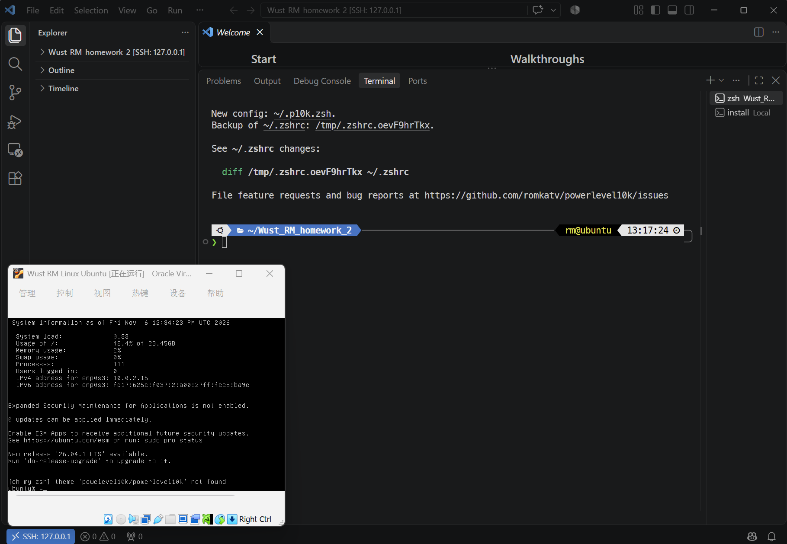

# Wust-RM-27赛季考核

## Task1



Ubuntu是纯命令行 用ssh接到了VScode上 只能美化成这样了 尽力了

## Task2
```bash
#!/bin/bash
build() {
    if [ ! -f app ] || [ main.cpp -nt app ]; then
        g++ main.cpp -o app
        if [ $? -ne 0 ]; then
            echo "编译失败" >&2
            exit 1
        fi
    else
        echo "已是最新可执行文件"
    fi
}
if [ "$1" == "build" ]; then
    build
elif [ "$1" == "run" ]; then
    build
    if [ "$2" == "--" ]; then
        ./app "$3" "$4"
    else
        ./app
    fi
elif [ "$1" == "clean" ]; then
    rm -f app
elif [ "$1" == "help" ]; then
    echo "Usage: $0 [build(编译项目)|run(运行项目)|clean(清除编译产物)|help(帮助信息)]"
else
    echo "未知命令： $1" >&2
    exit 1
fi
```

## Task3
```cpp
#include <iostream>
using namespace std;
#include <vector>
#include <queue>
#include <cmath>
#include <climits>

struct Node{
    int x,y;
    int g,f;
    bool operator<(const Node& other) const{
        return f>other.f;
    }
};

void dfs(vector<vector<char>>& map,vector<vector<bool>>& visited,int& k,int x,int y){
visited[x][y]=true;
k++;
int dr[4]={-1,0,1,0};
int dc[4]={0,1,0,-1};
for(int i=0;i<4;i++){
    int nx=x+dr[i];
    int ny=y+dc[i];
    if(nx>=0 && nx<map.size() && ny>=0 && ny<map[0].size() && map[nx][ny]!='#' && !visited[nx][ny]) dfs(map,visited,k,nx,ny);
}
}

int main(){
int R,C;
int sx,sy,gx,gy;
int k=0;
cin>>R>>C;
vector<vector<char>> map(R, vector<char>(C));
vector<vector<bool>> visited(R, vector<bool>(C,false));
for(int i=0;i<R;i++){
    for(int j=0;j<C;j++){
        cin>>map[i][j];
        if(map[i][j]=='S'){
            sx=i;
            sy=j;//记录起点坐标
        }
        if(map[i][j]=='G'){
            gx=i;
            gy=j;//记录终点坐标
        }
    }
}//录入地图信息
dfs(map,visited,k,sx,sy);
cout<<"reachable cells: "<<k<<endl;

int regions=1;//计算孤岛
vector<vector<bool>> visited2(R, vector<bool>(C));
for(int i=0;i<R;i++){
    for(int j=0;j<C;j++){
        if(map[i][j]!='#' && !visited[i][j]){
            regions++;
            dfs(map,visited,k,i,j);
        }
    }
}
cout<<"regions: "<<regions<<endl;

//计算最小代价 
vector<vector<int>> dist(R, vector<int>(C,INT_MAX));
dist[sx][sy]=0;
priority_queue<Node> pq;
pq.push({sx,sy,0,abs(sx-gx)+abs(sy-gy)});
while(!pq.empty()){
    Node cur=pq.top();
    pq.pop();
    if(cur.x==gx && cur.y==gy){
        cout<<"cost:"<<cur.g<<endl;
        return 0;
    }
    else{
        int dr[4]={-1,0,1,0};
        int dc[4]={0,1,0,-1};
        for(int i=0;i<4;i++){
            int nx=cur.x+dr[i];
            int ny=cur.y+dc[i];
            if(nx>=0 && nx<map.size() && ny>=0 && ny<map[0].size() && map[nx][ny]!='#'){
                int step;
                if(map[nx][ny]<='9' && map[nx][ny]>='2'){
                    step=map[nx][ny]-'0';
                }
                if(map[nx][ny]=='.'||map[nx][ny]=='S'||map[nx][ny]=='G'){
                    step=1;
                }
                int new_g=cur.g+step;
                if(new_g<dist[nx][ny]){
                    dist[nx][ny]=new_g;
                    pq.push({nx,ny,new_g,new_g+abs(nx-gx)+abs(ny-gy)});
                }
            }
                
        }
    }

}
cout<<"-1"<<endl;
return 0;
}
```

## Task4
```cpp
#include <iostream>
#include <cstdint>
#include <type_traits>
using namespace std;
namespace virt {
    class ImageSource {
        public:
            virtual ~ImageSource() = default;
            virtual int width() const = 0;
            virtual int height() const = 0;
            virtual unsigned char at(int x, int y) const = 0;
    };

    class CameraSource : public ImageSource {
        private:
            CameraFrame frame_;  
        public: explicit CameraSource(CameraFrame f):frame_(f){}
        int width() const override { return frame_.w; }
        int height() const override { return frame_.h; }
        unsigned char at(int x, int y) const override {
            return frame_.buf[y * frame_.w + x];
        }
        
    };
    class RosSource    : public ImageSource {
        private:
            RosImage frame_;
        public: explicit RosSource(RosImage f):frame_(f){}
        int width() const override { return frame_.w; }
        int height() const override { return frame_.h; }
        unsigned char at(int x, int y) const override{
            return frame_.data[y*frame_.step +x];
        }

    };
    class VideoSource  : public ImageSource {
        private:
            VideoFrame frame_;
        public: explicit VideoSource(VideoFrame f):frame_(f){}
        int width() const override { return frame_.w; }
        int height() const override { return frame_.h; }
        unsigned char at(int x, int y) const override{
            return frame_.max(yuv[y*w +x]-16,0);
        }
    };
    std::uint64_t preprocess(const ImageSource& src){
        std::uint64_t sum = 0;
        for(int y=0;y<src.height();y++){
            for(int x=0;x<src.width();x++){
                sum += src.at(x,y);
            }
        }
        return sum;
    }
}
namespace tmpl {
template <typename Frame>
std::uint64_t preprocess(const Frame& f){
    std::uint64_t sum = 0;
    for(int y=0;y<f.h;y++){
        for(int x=0;x<f.w;x++){
            if constexpr (std::is_same_v<Frame, CameraFrame>) {
                sum += f.buf[y * f.w + x];
            } else if constexpr (std::is_same_v<Frame, RosImage>) {
                sum += f.data[y * f.step + x];
            } else if constexpr (std::is_same_v<Frame, VideoFrame>) {
                sum += std::max(f.yuv[y * f.w + x] - 16, 0);
                sum += val>16 ?(val-16):0;
            }
        }
    }   
}return sum;
}
```
## Task5
```cpp
#include "my_scheduler.hpp"

Action MyScheduler::decide(const View& v, int e) {
    int my_floor = v.cars[e].floor;
    bool is_full = (v.cars[e].load >= v.cars[e].capacity);
    Action f_action = Action::Idle;//默认发呆

    if (v.cars[e].car_call[my_floor] != -1) {
        f_action =(current_dir[e]==-1)?Action::OpenDown:Action::OpenUp;
        return f_action;//内部需求
    }
    //高峰期响应
    int up_peak[5][2]={{29100,30000},{36300,37200},{49500,50400},{56700,57600},{66300,67200}};
    int down_peak[5][2]={{36000,36600},{43200,43800},{56400,57000},{61200,61800},{73200,73800}};
    bool is_up_peak=false;
    bool is_down_peak=false;
    for(int i=0;i<5;++i){
        if(v.now>up_peak[i][0] &&v.now<up_peak[i][1]){
            is_up_peak=true;
            break;
        }
    }
    for(int i=0;i<5;++i){
        if(v.now>down_peak[i][0] &&v.now<down_peak[i][1]){
            is_down_peak=true;
            break;
        }
    }
    if(is_up_peak){
        if(e==0 && !is_full && my_floor>1 && v.cars[e].load==0){
            current_dir[e]=-1;
            f_action=Action::Down;
        }else if(e==1 &&my_floor>1 &&!is_full &&v.cars[0].floor!=1){
            if(v.hall_down[my_floor]!=-1){
                f_action=Action::OpenDown;
                current_dir[e]=-1;
            }
        }
    }else if(is_down_peak){
        if(e==0 && !is_full && my_floor<6 && v.cars[e].load==0){
            current_dir[e]=1;
        }else if(e==1 &&my_floor<6 &&!is_full && v.cars[0].floor!=6){
            if(v.hall_down[my_floor]!=-1){
                current_dir[e]=1;
            }
        }
    }
    //外部响应
    if (!is_full) {
        if(is_up_peak){
            if(v.hall_up[my_floor]!=-1 && current_dir[e]!=-1){
                current_dir[e]=1;
                f_action=Action::OpenUp;
            }
        }else if(is_down_peak){
            if(v.hall_up[my_floor]!=-1 && current_dir[e]!=1){
                current_dir[e]=-1;
                f_action=Action::OpenDown;
            }
        }else{
            if (v.hall_down[my_floor] != -1 && current_dir[e] != 1) {
                current_dir[e] = -1;
                f_action=Action::OpenDown;
            }
            if (v.hall_up[my_floor] != -1 && current_dir[e] != -1) {
                current_dir[e] = 1;
                f_action=Action::OpenUp;
            }
        }
    }
    //更新需求状态
    bool target_up = false;
    bool target_down = false;
    if(f_action==Action::Idle){
        

        for (int f = my_floor + 1; f <= 6; ++f) {
            if (v.cars[e].car_call[f] != -1 || v.hall_up[f] != -1) {
                target_up = true; 
                break;
            }
        }
        for (int f = my_floor - 1; f >= 1; --f) {
            if (v.cars[e].car_call[f] != -1 || v.hall_down[f] != -1) {
                target_down = true; 
                break;
            }
        }
    }
        //运行逻辑
        if (current_dir[e] == 1) {
            if (target_up){
                f_action=Action::Up;
            }else if (target_down) {
                current_dir[e] = -1;
                f_action=Action::Down; 
            } else {
                current_dir[e] = 0;
            }
        } else if (current_dir[e] == -1) {
            if (target_down){
              f_action=Action::Down;  
            } else if (target_up) {
                current_dir[e] = 1;
                f_action=Action::Up;
            } else {
                current_dir[e] = 0;
            }
        } else {
            if (target_up) {
                current_dir[e] = 1;
                f_action=Action::Up;
            } else if (target_down) {
                current_dir[e] = -1;
                f_action=Action::Down;
            }
        }
    
    return f_action;
}
```
尽力了 拼尽全力过不了60大关
## Q&A
1. 介绍一些在c++中你常用的STL容器
    vector动态数组 deque双端队列 priority优先队列

2. 你对c++新标准有哪些了解，有哪些实用的特性，简要介绍一下
    范围for循环 智能指针 遍历容器时的自动类型auto 

3. 为什么c++需要预先编译而不能像python一样直接运行，从源文件到可执行文件编译工具链做了哪些操作
    cpp是编译型语言
    运行时先预处理 然后由编译器进行编译 再进行汇编 转义为机器码文件 最后将文件和系统库链接生成执行程序

4. 在linux中为什么要用sudo，为什么不全程使用root账户
    sudo是以管理员程序运行该命令 不全程使用root防止失误删除系统文件

5. 在RM中算法组主要做什么工作，新赛季中有哪些规则变动属于算法组的工作 
    对敌方装甲识别 炮台自定位 哨兵的自主运行 飞镖姿态调整 雷达波解析好像也是
    赛季改动后装甲改为点阵 装甲的识别和定位 英雄和工程融合为重装 哨兵的姿态切换 敌方激光对无人机的反制

6. 请你总结一下这段时间的学习经历及经验，以及后续对RM比赛的计划
    RM是很锻炼个人学习能力的一个社团（这残酷的训练差点要了我的命）几乎所有的知识都是通过在b站上找教学视频加ai辅助学习的
    说实话 这种领先几乎所有同学的学习很艰苦也很困难 但这和未来的就业时的情景类似 由需求驱动学习 也理所当然没有人会事无巨细的教学所有的知识 尤其算法的大佬们又不是计算机专业的 一路学过来除了热爱更有令人难以想象的毅力 这段学习的时间很痛苦也很快乐 专注于代码 专注于作品 哪怕最后没办法进入战队 相信也会成为人生中的财富（感慨）
    （这段其实是从报名表上copy过来的（）
